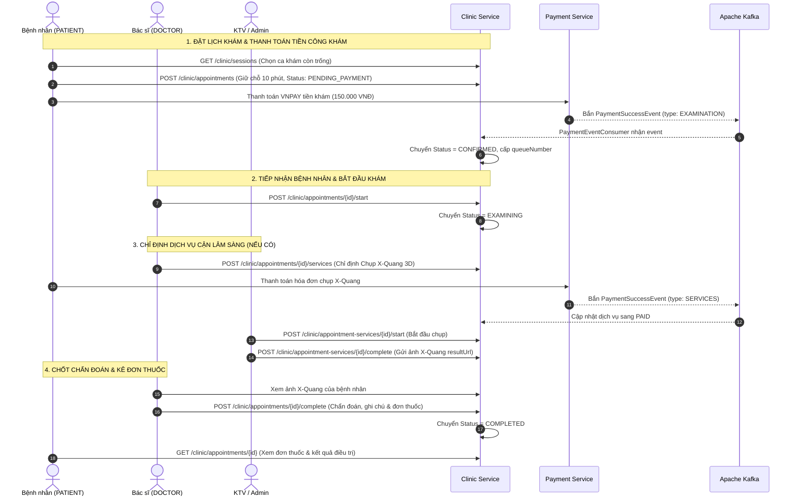

# TÀI LIỆU CHI TIẾT API - CLINIC-SERVICE (HỆ THỐNG ĐẶT LỊCH & QUẢN LÝ PHÒNG KHÁM NHA KHOA)

## 1. TỔNG QUAN SERVICE (SERVICE OVERVIEW)

- **Tên Service:** `clinic-service`
- **Cổng dịch vụ trực tiếp (Port):** `9003`
- **Cổng thông qua API Gateway:** `9000` (được định tuyến qua `http://localhost:9000/clinic/**` và `http://localhost:9000/internal/clinic/**`)
- **Cơ sở dữ liệu:** PostgreSQL (`jdbc:postgresql://localhost:5432/clinic_service`)
- **Message Broker:** Apache Kafka (`localhost:9092`)
  - **Consumer Topic:** `payment-events` (Nhóm: `clinic-service-group`)
  - **Payload Event:** `PaymentSuccessEvent` (Xác nhận tự động phí khám hoặc phí dịch vụ cận lâm sàng)
- **Tác vụ nền tự động (Background Job):** `BookingExpiryJob`
  - Quét mỗi 60 giây (`clinic.expiry-interval-ms: 60000`).
  - Tự động hủy các lịch hẹn `PENDING_PAYMENT` đã giữ chỗ quá 10 phút (`clinic.booking-hold-minutes: 10`) mà chưa thanh toán để hoàn trả slot ca khám cho bệnh nhân khác.
- **Discovery Service:** Netflix Eureka (`http://localhost:8761/eureka/`)
- **Giao tiếp liên dịch vụ (Inter-service Communication):**
  - **Gọi sang `user-service`** qua OpenFeign (`UserClient`): Tự động nạp thông tin Bác sĩ theo lô (`doctorName`, `doctorRank`, `doctorAvatar`, `doctorPhone`).
  - **Cung cấp cho `payment-service`**: Tính toán chi phí khám bệnh, gắn mã hóa đơn dịch vụ cận lâm sàng.
  - **Cung cấp cho `statistic-service`**: Toàn bộ báo cáo hiệu suất khám, ca làm việc, tỷ lệ hoàn thành, top thuốc và dịch vụ nha khoa.

---

### 1.1. Vai trò trong Hệ sinh thái Nha khoa Primecare
1. **Quản lý Ca khám bệnh (`ExamSession`):** Quản trị viên phân ca trực Sáng/Chiều cho bác sĩ, định mức số lượng bệnh nhân tối đa (1 - 20 bệnh nhân/ca), giá tiền công khám.
2. **Quản lý Lịch hẹn & Hàng đợi khám (`Appointment`):** Cấp số thứ tự khám (`queueNumber`), quản lý trạng thái từ lúc đặt chỗ, chờ thanh toán, đang khám, đến khi hoàn tất.
3. **Danh mục Dịch vụ Nha khoa (`MedicalService`):** Quản lý giá tiền, phòng thực hiện, loại dịch vụ (chụp phim X-Quang, CT Cone Beam 3D, cạo vôi răng, nhổ răng khôn, niềng răng, cấy ghép Implant...).
4. **Danh mục Thuốc (`Medication`):** Quản lý hoạt chất, hàm lượng, dạng bào chế, đơn vị tính, hướng dẫn sử dụng phục vụ kê đơn.
5. **Quy trình Khám bệnh Lâm sàng:** Hỗ trợ bác sĩ bắt đầu khám, chỉ định dịch vụ cận lâm sàng, xem kết quả trả về, chốt chẩn đoán bệnh lý răng miệng và xuất đơn thuốc.

---

## 2. QUY CHUẨN DỮ LIỆU CHUNG (STANDARDS & CONVENTIONS)

### 2.1. Cấu trúc Response chuẩn (`ApiResponse<T>`)
```json
{
  "code": 200,
  "message": "Thông điệp (nếu có)",
  "result": { ... }
}
```

### 2.2. Danh mục Trạng thái Lịch hẹn (`AppointmentStatus`)
| Trạng thái | Ý nghĩa nghiệp vụ nha khoa |
| :--- | :--- |
| `PENDING_PAYMENT` | Đang giữ chỗ khám, chờ bệnh nhân thanh toán tiền công khám (hạn 10 phút). |
| `CONFIRMED` | Đã thanh toán thành công, được cấp số thứ tự và xác nhận lịch khám. |
| `EXAMINING` | Bác sĩ đã bắt đầu tiếp nhận bệnh nhân vào phòng khám điều trị. |
| `COMPLETED` | Bác sĩ đã hoàn tất ca khám, chốt kết quả chẩn đoán và kê đơn thuốc xong. |
| `CANCELLED` | Bệnh nhân chủ động hủy lịch khi chưa thanh toán phí khám. |
| `EXPIRED` | Quá hạn 10 phút giữ chỗ mà chưa thanh toán, hệ thống tự động hủy và nhả slot. |
| `REFUND_PENDING` | Lịch hẹn phát sinh yêu cầu hoàn tiền (do ca khám bị hủy bất khả kháng). |

### 2.3. Danh mục Trạng thái Ca khám (`SessionStatus`)
| Trạng thái | Ý nghĩa |
| :--- | :--- |
| `OPEN` | Ca khám đang mở, cho phép bệnh nhân đặt lịch hẹn trực tuyến. |
| `CLOSED` | Ca khám đã đóng (do quản trị viên đóng hoặc đã đủ số lượng bệnh nhân). |

### 2.4. Danh mục Ca khám trong ngày (`Shift`)
| Ca khám | Khung giờ làm việc tiêu chuẩn |
| :--- | :--- |
| `MORNING` | Ca sáng: `08:00 - 12:00` |
| `AFTERNOON` | Ca chiều: `13:30 - 17:30` |

### 2.5. Danh mục Phân loại Dịch vụ Y tế (`ServiceType`)
| Loại dịch vụ | Ý nghĩa trong điều trị nha khoa |
| :--- | :--- |
| `DENTAL` | Thủ thuật nha khoa trực tiếp (Cạo vôi, trám răng, nhổ răng, tẩy trắng răng, bọc sứ...). |
| `IMAGING` | Chẩn đoán hình ảnh (Chụp X-quang quanh chóp, phim toàn cảnh Panorama, Cephalo, CT 3D Cone Beam). |
| `LAB_TEST` | Xét nghiệm cận lâm sàng (Xét nghiệm máu đông, tiểu đường... trước khi phẫu thuật Implant/nhổ răng). |
| `OTHER` | Dịch vụ nha khoa hoặc xét nghiệm tổng quát khác. |

### 2.6. Danh mục Trạng thái Dịch vụ Chỉ định (`ServiceStatus`)
| Trạng thái | Ý nghĩa |
| :--- | :--- |
| `ORDERED` | Bác sĩ vừa chỉ định trong buổi khám, chờ bệnh nhân thanh toán hóa đơn dịch vụ. |
| `IN_PROGRESS` | Kỹ thuật viên / Bác sĩ đã tiếp nhận và đang tiến hành chụp chiếu/xét nghiệm. |
| `COMPLETED` | Đã thực hiện xong, có file ảnh kết quả (`resultUrl`) và kết luận của kỹ thuật viên. |
| `CANCELLED` | Bác sĩ hủy chỉ định (chỉ được hủy khi chưa thanh toán). |

### 2.7. Bảng mã lỗi nghiệp vụ (`ErrorCode`)
| Mã Code | HTTP Status | Thông điệp lỗi | Mô tả |
| :---: | :---: | :--- | :--- |
| `200` | `200 OK` | Thành công | Request xử lý thành công |
| `400` | `400 BAD_REQUEST` | `Invalid request` | Dữ liệu đầu vào không hợp lệ hoặc vi phạm logic nghiệp vụ |
| `401` | `401 UNAUTHORIZED` | `Unauthenticated` | Chưa đăng nhập hoặc Access Token không hợp lệ / hết hạn |
| `403` | `403 FORBIDDEN` | `Do not have permission` | Người dùng không đủ quyền thực hiện hành động |
| `404` | `404 NOT_FOUND` | `Resource not found` | Không tìm thấy ca khám, lịch hẹn, dịch vụ hoặc thuốc |
| `409` | `409 CONFLICT` | `Data conflict occurred` | Trùng lịch, ca khám đã đủ chỗ, hoặc trạng thái không cho phép thao tác |
| `9999` | `500 INTERNAL` | `Uncategorized error` | Lỗi hệ thống nội bộ |

---

## 3. DANH SÁCH CHI TIẾT CÁC API

---

### PHẦN I: QUẢN LÝ CA KHÁM (EXAM SESSIONS)
> **Base Path:** `/clinic`

#### 1. Tạo ca khám bệnh mới cho Bác sĩ (Create Session)
- **Endpoint:** `POST /clinic/sessions`
- **Mô tả:** Admin phân công ca trực cho bác sĩ nha khoa theo ngày, ca khám (sáng/chiều), số bệnh nhân tối đa và phí khám.
- **Quyền hạn:** `ADMIN`
- **Headers:** `Authorization: Bearer <admin_token>`
- **Request Body:**
```json
{
  "doctorId": 2,
  "examDate": "2026-11-01",
  "shift": "MORNING",
  "examinationFee": 150000,
  "maxPatients": 12
}
```
- **Response Success (`200 OK`):**
```json
{
  "code": 200,
  "message": null,
  "result": {
    "id": 101,
    "createdAt": "2026-10-28T04:30:00Z",
    "version": 0,
    "doctorId": 2,
    "doctorName": "ThS. BS Trần Quang Minh",
    "doctorRank": "MASTER",
    "doctorAvatar": "https://storage.nhakhoa.vn/avatars/dr_minh.jpg",
    "doctorPhone": "0912345678",
    "examDate": "2026-11-01",
    "shift": "MORNING",
    "examinationFee": 150000,
    "maxPatients": 12,
    "lastQueueNumber": 0,
    "status": "OPEN",
    "availableSlots": 12
  }
}
```

---

#### 2. Lấy danh sách ca khám đang mở để đặt lịch (Get Available Sessions)
- **Endpoint:** `GET /clinic/sessions`
- **Mô tả:** Bệnh nhân tra cứu các ca khám đang mở (`OPEN`) để chọn đặt lịch hẹn, có thể lọc theo ngày, bác sĩ hoặc ca sáng/chiều.
- **Quyền hạn:** `PATIENT`, `USER`
- **Headers:** `Authorization: Bearer <token>`
- **Query Parameters:**
  - `date` (Bắt buộc, `yyyy-MM-dd`): Ngày khám
  - `doctorId` (Tùy chọn): Mã định danh bác sĩ
  - `shift` (Tùy chọn): `MORNING` hoặc `AFTERNOON`
  - `page` (Tùy chọn, Default: `0`), `size` (Tùy chọn, Default: `20`)
- **Example Request:** `GET /clinic/sessions?date=2026-11-01&shift=MORNING&page=0&size=10`
- **Response Success (`200 OK`):**
```json
{
  "code": 200,
  "message": null,
  "result": {
    "content": [
      {
        "id": 101,
        "doctorId": 2,
        "doctorName": "ThS. BS Trần Quang Minh",
        "doctorRank": "MASTER",
        "doctorAvatar": "https://storage.nhakhoa.vn/avatars/dr_minh.jpg",
        "examDate": "2026-11-01",
        "shift": "MORNING",
        "examinationFee": 150000,
        "maxPatients": 12,
        "availableSlots": 8,
        "status": "OPEN"
      }
    ],
    "totalElements": 1,
    "totalPages": 1
  }
}
```

---

#### 3. Bác sĩ xem danh sách ca trực của mình (Get My Sessions)
- **Endpoint:** `GET /clinic/sessions/my`
- **Mô tả:** Bác sĩ đăng nhập xem các ca khám mà mình phụ trách (hôm nay hoặc các ngày sắp tới).
- **Quyền hạn:** `DOCTOR`
- **Headers:** `Authorization: Bearer <doctor_token>`
- **Query Parameters:**
  - `date` (Tùy chọn, `yyyy-MM-dd`): Lọc theo ngày cụ thể (để trống để xem tất cả)
  - `page`, `size`
- **Example Request:** `GET /clinic/sessions/my?date=2026-11-01`
- **Response Success (`200 OK`):** Danh sách ca trực kèm số lượng bệnh nhân đã nhận.

---

#### 4. Quản trị viên quản lý danh sách ca khám (Get Admin Sessions)
- **Endpoint:** `GET /clinic/sessions/admin`
- **Mô tả:** Màn hình quản lý ca khám toàn diện dành cho Admin, lọc theo mọi tiêu chí (ngày, bác sĩ, ca, trạng thái).
- **Quyền hạn:** `ADMIN`
- **Headers:** `Authorization: Bearer <admin_token>`
- **Query Parameters:**
  - `date` (Tùy chọn), `doctorId` (Tùy chọn), `shift` (Tùy chọn), `status` (`OPEN` / `CLOSED`), `page`, `size`, `sort` (Mặc định: `id,desc`)
- **Example Request:** `GET /clinic/sessions/admin?status=OPEN&page=0&size=20&sort=id,desc`

---

#### 5. Đóng / Mở ca khám (Toggle Session Status)
- **Endpoint:** `PATCH /clinic/sessions/{id}/status` hoặc `PATCH /clinic/sessions/{id}/toggle-status`
- **Mô tả:** Admin bật/tắt trạng thái ca khám. Nếu ca đang `OPEN` sẽ chuyển thành `CLOSED` (ngưng nhận đặt lịch thêm) và ngược lại.
- **Quyền hạn:** `ADMIN`
- **Path Variable:** `id` (Long) - ID ca khám
- **Response Success (`200 OK`):** Ca khám sau khi đã chuyển trạng thái.

---

#### 6. Xem danh sách lịch hẹn trong ca khám (Get Session Appointments)
- **Endpoint:** `GET /clinic/sessions/{id}/appointments`
- **Mô tả:** Bác sĩ hoặc Admin xem danh sách bệnh nhân đã đặt chỗ trong ca khám đó kèm số thứ tự khám (`queueNumber`).
- **Quyền hạn:** `ADMIN`, `DOCTOR`
- **Path Variable:** `id` (Long) - ID ca khám
- **Query Parameters:**
  - `status` (Tùy chọn): Lọc theo `CONFIRMED`, `EXAMINING`, `COMPLETED`...
- **Response Success (`200 OK`):**
```json
{
  "code": 200,
  "message": null,
  "result": [
    {
      "id": 501,
      "sessionId": 101,
      "patientId": 12,
      "queueNumber": 1,
      "examinationFee": 150000,
      "status": "CONFIRMED",
      "symptoms": "Đau nhức răng hàm dưới bên trái khi nhai",
      "examinationInvoiceId": 901
    }
  ]
}
```

---

### PHẦN II: ĐẶT LỊCH & QUẢN LÝ LỊCH HẸN (APPOINTMENTS)
> **Base Path:** `/clinic/appointments`

#### 7. Đặt lịch hẹn khám bệnh (Book Appointment)
- **Endpoint:** `POST /clinic/appointments`
- **Mô tả:** Bệnh nhân chọn ca khám và mô tả triệu chứng răng miệng. Hệ thống cấp số thứ tự giữ chỗ và đặt thời hạn thanh toán là **10 phút** (`expiresAt`).
- **Quyền hạn:** `PATIENT`, `USER`
- **Headers:** `Authorization: Bearer <patient_token>`
- **Request Body:**
```json
{
  "sessionId": 101,
  "symptoms": "Răng số 6 hàm dưới ê buốt kéo dài, nướu sưng nhẹ"
}
```
- **Response Success (`200 OK`):**
```json
{
  "code": 200,
  "message": null,
  "result": {
    "id": 501,
    "createdAt": "2026-10-28T04:45:00Z",
    "sessionId": 101,
    "patientId": 12,
    "queueNumber": 2,
    "examinationFee": 150000,
    "status": "PENDING_PAYMENT",
    "expiresAt": "2026-10-28T04:55:00Z",
    "symptoms": "Răng số 6 hàm dưới ê buốt kéo dài, nướu sưng nhẹ"
  }
}
```

---

#### 8. Xem danh sách lịch hẹn của tôi (Get My Appointments)
- **Endpoint:** `GET /clinic/appointments/my`
- **Mô tả:** Bệnh nhân xem lịch sử các lần khám bệnh của chính mình (sắp tới, đã khám, đã hủy...).
- **Quyền hạn:** `PATIENT`, `USER`
- **Headers:** `Authorization: Bearer <patient_token>`
- **Query Parameters:** `page`, `size`, `sort`
- **Response Success (`200 OK`):** Danh sách lịch hẹn phân trang của bệnh nhân hiện tại.

---

#### 9. Xem chi tiết lịch hẹn khám bệnh (Get Appointment Detail)
- **Endpoint:** `GET /clinic/appointments/{id}`
- **Mô tả:** Xem toàn bộ hồ sơ chi tiết của một ca khám: Thông tin ca trực, kết quả chẩn đoán, danh sách dịch vụ cận lâm sàng đã chỉ định (kèm ảnh kết quả X-quang/xét nghiệm) và đơn thuốc bác sĩ đã kê.
- **Quyền hạn:** Người đặt lịch, Bác sĩ phụ trách hoặc `ADMIN`
- **Path Variable:** `id` (Long) - ID lịch hẹn
- **Response Success (`200 OK`):**
```json
{
  "code": 200,
  "message": null,
  "result": {
    "appointment": {
      "id": 501,
      "status": "COMPLETED",
      "symptoms": "Răng số 6 hàm dưới ê buốt",
      "diagnosis": "Sâu răng ngà sâu tiến triển, viêm tủy răng có hồi phục",
      "doctorNote": "Hẹn tái khám sau 7 ngày để kiểm tra miếng trám"
    },
    "session": {
      "id": 101,
      "doctorName": "ThS. BS Trần Quang Minh",
      "examDate": "2026-11-01",
      "shift": "MORNING"
    },
    "services": [
      {
        "id": 701,
        "serviceName": "Chụp X-Quang chóp răng kỹ thuật số",
        "serviceType": "IMAGING",
        "unitPrice": 100000,
        "roomNumber": "Phòng X-Quang P.102",
        "status": "COMPLETED",
        "resultUrl": "https://storage.nhakhoa.vn/xray/patient_501_tooth6.jpg",
        "note": "Hình ảnh thấu quang sát buồng tủy răng 46"
      }
    ],
    "medications": [
      {
        "id": 801,
        "medicineName": "Amoxicillin + Clavulanic Acid",
        "strength": "625mg",
        "quantity": 14,
        "dosage": "1 viên",
        "frequency": "2 lần / ngày (Sau ăn sáng và tối)",
        "durationDays": 7,
        "instruction": "Uống sau ăn no, uống nhiều nước"
      }
    ]
  }
}
```

---

#### 10. Bệnh nhân hủy lịch hẹn chưa thanh toán (Cancel Appointment)
- **Endpoint:** `POST /clinic/appointments/{id}/cancel`
- **Mô tả:** Cho phép bệnh nhân hủy lịch hẹn khi còn ở trạng thái `PENDING_PAYMENT`. Hệ thống sẽ giải phóng slot cho ca khám.
- **Quyền hạn:** `PATIENT`, `USER`
- **Path Variable:** `id` (Long) - ID lịch hẹn
- **Response Success (`200 OK`):** Lịch hẹn chuyển sang trạng thái `CANCELLED`.

---

#### 11. Bác sĩ bắt đầu buổi khám (Start Appointment)
- **Endpoint:** `POST /clinic/appointments/{id}/start`
- **Mô tả:** Bác sĩ tiếp nhận bệnh nhân đã thanh toán (`CONFIRMED`) vào ghế khám nha khoa, chuyển trạng thái lịch hẹn sang `EXAMINING`.
- **Quyền hạn:** `DOCTOR`
- **Path Variable:** `id` (Long) - ID lịch hẹn
- **Response Success (`200 OK`):** Trạng thái lịch hẹn chuyển thành `EXAMINING`.

---

#### 12. Quản trị viên xem toàn bộ lịch khám của một bệnh nhân/người dùng (Get Patient Appointments by Patient ID)
- **Endpoint:** `GET /clinic/appointments/patient/{patientId}`
- **Mô tả:** Cho phép Quản trị viên (ADMIN) tra cứu danh sách toàn bộ các lịch hẹn/lần khám của một người dùng hoặc bệnh nhân bất kỳ trong hệ thống. Dữ liệu trả về được tự động làm giàu thông tin người dùng (`patientName`, `patientPhone`, `patientEmail`), ca khám (`examDate`, `shift`), và bác sĩ phụ trách (`doctorName`, `doctorRank`).
- **Quyền hạn:** `ADMIN` (Người dùng thông thường hoặc bác sĩ truy cập sẽ nhận mã lỗi `403 FORBIDDEN`)
- **Headers:** `Authorization: Bearer <admin_token>`
- **Path Variable:** `patientId` (Long) - ID người dùng/bệnh nhân cần xem
- **Response Success (`200 OK`):**
```json
{
  "code": 200,
  "message": null,
  "result": [
    {
      "id": 1,
      "sessionId": 1,
      "patientId": 2,
      "queueNumber": 1,
      "examinationFee": 150000,
      "status": "COMPLETED",
      "symptoms": "Đau buốt răng hàm dưới",
      "diagnosis": "Sâu răng ngà nông răng 46",
      "doctorNote": "Hẹn tái khám sau 7 ngày",
      "patientName": "Regular User",
      "patientPhone": "0123456789",
      "patientEmail": "user@gmail.com",
      "patientGender": "FEMALE",
      "patientAddress": "Hà Nội",
      "examDate": "2026-10-25",
      "shift": "MORNING",
      "doctorId": 4,
      "doctorName": "TS. BS. Trần Thị B",
      "doctorRank": "DOCTORATE"
    }
  ]
}
```
- **Response Error (`403 FORBIDDEN` - Khi không phải ADMIN):**
```json
{
  "code": 403,
  "message": "Do not have permission",
  "result": null
}
```

---

### PHẦN III: QUY TRÌNH LÂM SÀNG, CHỈ ĐỊNH DỊCH VỤ & KÊ ĐƠN
> **Base Path:** `/clinic`

#### 13. Bác sĩ chỉ định dịch vụ cận lâm sàng/thủ thuật (Order Medical Services)
- **Endpoint:** `POST /clinic/appointments/{id}/services`
- **Mô tả:** Trong quá trình khám, bác sĩ chỉ định bệnh nhân đi chụp X-quang, xét nghiệm hoặc làm các thủ thuật điều trị.
- **Quyền hạn:** `DOCTOR`
- **Path Variable:** `id` (Long) - ID lịch hẹn
- **Request Body:**
```json
{
  "items": [
    {
      "serviceId": 1,
      "note": "Chụp cận chóp răng hàm dưới số 46"
    },
    {
      "serviceId": 4,
      "note": "Cạo vôi răng và đánh bóng 2 hàm"
    }
  ]
}
```
- **Response Success (`200 OK`):** Danh sách các dịch vụ chỉ định ở trạng thái `ORDERED`.

---

#### 14. Bác sĩ hủy dịch vụ đã chỉ định (Cancel Ordered Service)
- **Endpoint:** `POST /clinic/appointment-services/{id}/cancel`
- **Mô tả:** Bác sĩ hủy dịch vụ đã chỉ định nhầm (chỉ hủy được khi dịch vụ ở trạng thái `ORDERED` và chưa gắn hóa đơn thanh toán).
- **Quyền hạn:** `DOCTOR`
- **Path Variable:** `id` (Long) - ID của bản ghi `AppointmentService`
- **Response Success (`200 OK`):** Dịch vụ chuyển sang trạng thái `CANCELLED`.

---

#### 15. Bắt đầu thực hiện dịch vụ cận lâm sàng (Start Service)
- **Endpoint:** `POST /clinic/appointment-services/{id}/start`
- **Mô tả:** Kỹ thuật viên X-Quang / Y tá tiếp nhận bệnh nhân sau khi đã đóng tiền dịch vụ, bắt đầu tiến hành chụp phim/xét nghiệm.
- **Quyền hạn:** `ADMIN` (hoặc Kỹ thuật viên)
- **Path Variable:** `id` (Long) - ID của bản ghi `AppointmentService`
- **Response Success (`200 OK`):** Dịch vụ chuyển sang trạng thái `IN_PROGRESS`.

---

#### 16. Hoàn tất hoặc cập nhật kết quả dịch vụ cận lâm sàng (Complete / Update Service Result)
- **Endpoint:** `POST /clinic/appointment-services/{id}/complete`
- **Mô tả:** Kỹ thuật viên tải file/ảnh kết quả chụp phim nha khoa (link Supabase CDN) và ghi nhận kết quả mô tả để bác sĩ xem lại. Cho phép tải lên lần đầu khi dịch vụ ở trạng thái `IN_PROGRESS` và tải lại/cập nhật kết quả khi dịch vụ đã ở trạng thái `COMPLETED` (miễn là ca khám vẫn đang trong trạng thái `EXAMINING`).
- **Quyền hạn:** `ADMIN`
- **Path Variable:** `id` (Long) - ID của bản ghi `AppointmentService`
- **Request Body:**
```json
{
  "resultUrl": "https://storage.nhakhoa.vn/xray/2026/patient_501_tooth46.png",
  "note": "Hình ảnh tiêu xương vùng chẽ răng 46, ống tủy chân xa thông suốt"
}
```
- **Response Success (`200 OK`):** Dịch vụ chuyển/duy trì trạng thái `COMPLETED`.

---

#### 17. Bác sĩ hoàn tất ca khám, chốt chẩn đoán & kê đơn thuốc (Complete Appointment)
- **Endpoint:** `POST /clinic/appointments/{id}/complete`
- **Mô tả:** Bác sĩ kết luận chẩn đoán bệnh lý răng miệng, ghi chú lời dặn và kê đơn thuốc cho bệnh nhân. Lịch hẹn chuyển sang trạng thái kết thúc `COMPLETED`.
- **Quyền hạn:** `DOCTOR`
- **Path Variable:** `id` (Long) - ID lịch hẹn
- **Request Body:**
```json
{
  "diagnosis": "Viêm nha chu mạn tính quanh răng 46, sâu men mặt nhai",
  "doctorNote": "Kiêng đồ ăn quá nóng/lạnh trong 48h. Vệ sinh bằng chỉ nha khoa.",
  "medications": [
    {
      "medicationId": 5,
      "quantity": 10,
      "dosage": "1 viên (500mg)",
      "frequency": "Uống khi đau, cách nhau 6 tiếng",
      "durationDays": 3,
      "instruction": "Uống sau ăn, không uống rượu bia trong thời gian dùng thuốc"
    },
    {
      "medicationId": 8,
      "quantity": 1,
      "dosage": "15ml",
      "frequency": "Súc miệng 3 lần / ngày sau khi đánh răng",
      "durationDays": 10,
      "instruction": "Ngậm trong miệng 30 giây rồi nhổ ra, không nuốt"
    }
  ]
}
```
- **Response Success (`200 OK`):** Thông tin lịch hẹn chuyển thành `COMPLETED`.

---

### PHẦN IV: DANH MỤC DỊCH VỤ NHA KHOA (SERVICES CATALOG)
> **Base Path:** `/clinic/services`

#### 18. Xem danh mục dịch vụ y tế (Get Services List)
- **Endpoint:** `GET /clinic/services`
- **Mô tả:** Lấy danh sách dịch vụ nha khoa, hỗ trợ lọc theo loại dịch vụ (`DENTAL`, `IMAGING`, `LAB_TEST`), tìm kiếm từ khóa và phân trang.
- **Quyền hạn:** `ADMIN`, `DOCTOR`
- **Query Parameters:**
  - `type` hoặc `serviceType` (Tùy chọn): `DENTAL`, `IMAGING`, `LAB_TEST`, `OTHER`
  - `keyword` (Tùy chọn): Tìm theo tên hoặc mô tả dịch vụ
  - `includeInactive` (Tùy chọn, Default: `false`): Lấy cả dịch vụ đã ngưng hoạt động (chỉ `ADMIN`)
  - `page`, `size`, `sort`
- **Example Request:** `GET /clinic/services?type=DENTAL&keyword=trám+răng&page=0&size=10`
- **Response Success (`200 OK`):**
```json
{
  "code": 200,
  "message": null,
  "result": {
    "content": [
      {
        "id": 1,
        "name": "Trám răng thẩm mỹ Composite",
        "serviceType": "DENTAL",
        "price": 350000,
        "roomNumber": "P.201 - Ghế nha 03",
        "description": "Phục hồi hình thể răng sâu hoặc mẻ bằng vật liệu composite thẩm mỹ cao",
        "active": true
      }
    ],
    "totalElements": 1,
    "totalPages": 1
  }
}
```

---

#### 19. Thêm mới dịch vụ nha khoa (Create Service)
- **Endpoint:** `POST /clinic/services`
- **Quyền hạn:** `ADMIN`
- **Request Body:**
```json
{
  "name": "Nhổ răng khôn mọc lệch hàm dưới (Tiểu phẫu)",
  "serviceType": "DENTAL",
  "price": 1500000,
  "roomNumber": "Phòng Tiểu phẫu P.301",
  "description": "Nhổ răng số 8 ngầm hoặc nghiêng có mở xương, khâu thẩm mỹ",
  "active": true
}
```
- **Response Success (`200 OK`):** Dịch vụ nha khoa vừa được tạo thành công.

---

#### 20. Cập nhật thông tin dịch vụ nha khoa (Update Service)
- **Endpoint:** `PUT /clinic/services/{id}`
- **Quyền hạn:** `ADMIN`
- **Path Variable:** `id` (Long) - ID dịch vụ
- **Request Body:** Cấu trúc tương tự API tạo mới (thay đổi giá, phòng, mô tả...).
- **Response Success (`200 OK`):** Dữ liệu dịch vụ sau cập nhật.

---

#### 21. Bật / Tắt trạng thái hoạt động dịch vụ (Toggle Service Status)
- **Endpoint:** `PATCH /clinic/services/{id}/status` hoặc `toggle-status`
- **Mô tả:** Chuyển đổi trạng thái hoạt động `active` (true/false) để tạm ngưng cung ứng dịch vụ mà không cần xóa dữ liệu.
- **Quyền hạn:** `ADMIN`
- **Path Variable:** `id` (Long)

---

#### 22. Xóa dịch vụ khỏi danh mục (Delete Service)
- **Endpoint:** `DELETE /clinic/services/{id}`
- **Quyền hạn:** `ADMIN`
- **Path Variable:** `id` (Long)
- **Response Success (`200 OK`):**
```json
{
  "code": 200,
  "message": "Service deleted successfully",
  "result": null
}
```

---

### PHẦN V: DANH MỤC THUỐC NHA KHOA (MEDICATIONS CATALOG)
> **Base Path:** `/clinic/medications`

#### 23. Xem danh mục thuốc có phân trang & tìm kiếm (Get Medications)
- **Endpoint:** `GET /clinic/medications`
- **Mô tả:** Danh sách thuốc hỗ trợ bác sĩ kê đơn (kháng sinh răng, giảm đau răng, nước súc miệng chlorhexidine...).
- **Quyền hạn:** `ADMIN`, `DOCTOR`
- **Query Parameters:**
  - `keyword` (Tùy chọn): Tìm theo tên thuốc hoặc mô tả
  - `includeInactive` (Tùy chọn, Default: `false`): Dành cho Admin xem cả thuốc ngừng dùng
  - `page`, `size`, `sort`
- **Example Request:** `GET /clinic/medications?keyword=paracetamol&page=0&size=10`
- **Response Success (`200 OK`):**
```json
{
  "code": 200,
  "message": null,
  "result": {
    "content": [
      {
        "id": 1,
        "name": "Paracetamol (Panadol Extra)",
        "strength": "500mg/65mg",
        "dosageForm": "Viên nén bao phim",
        "unit": "Viên",
        "description": "Giảm đau nhức răng cấp tính và hạ sốt",
        "active": true
      }
    ],
    "totalElements": 1,
    "totalPages": 1
  }
}
```

---

#### 24. Thêm mới thuốc vào danh mục (Create Medication)
- **Endpoint:** `POST /clinic/medications`
- **Quyền hạn:** `ADMIN`
- **Request Body:**
```json
{
  "name": "Nước súc miệng Kin Gingival",
  "strength": "0.12% Chlorhexidine",
  "dosageForm": "Dung dịch súc họng",
  "unit": "Chai 250ml",
  "description": "Kháng khuẩn, phòng chống viêm nướu và viêm nha chu sau phẫu thuật",
  "active": true
}
```

---

#### 25. Cập nhật thông tin thuốc (Update Medication)
- **Endpoint:** `PUT /clinic/medications/{id}`
- **Quyền hạn:** `ADMIN`
- **Path Variable:** `id` (Long)
- **Request Body:** Cập nhật thông tin thuốc.

---

#### 26. Bật / Tắt trạng thái hoạt động thuốc (Toggle Medication Status)
- **Endpoint:** `PATCH /clinic/medications/{id}/status` hoặc `toggle-status`
- **Quyền hạn:** `ADMIN`
- **Path Variable:** `id` (Long)

---

#### 27. Xóa thuốc khỏi hệ thống (Delete Medication)
- **Endpoint:** `DELETE /clinic/medications/{id}`
- **Quyền hạn:** `ADMIN`
- **Path Variable:** `id` (Long)

---

### PHẦN VI: API NỘI BỘ CHO PAYMENT-SERVICE (INTERNAL PAYMENT APIS)
> **Base Path:** `/internal/clinic`  
> *(Các API này phục vụ giao tiếp giữa các vi dịch vụ qua OpenFeign, không yêu cầu xác thực người dùng ngoài)*

#### 28. Lấy thông tin phí khám cần thanh toán (Get Examination Charge)
- **Endpoint:** `GET /internal/clinic/appointments/{id}/examination-charge`
- **Mô tả:** `payment-service` gọi sang để biết số tiền công khám bệnh cần thu qua VNPAY.
- **Path Variable:** `id` (Long) - ID lịch hẹn
- **Response Success (`200 OK`):**
```json
{
  "code": 200,
  "message": null,
  "result": {
    "appointmentId": 501,
    "patientId": 12,
    "invoiceId": null,
    "type": "EXAMINATION",
    "amount": 150000,
    "itemIds": [],
    "expiresAt": "2026-10-28T04:55:00Z"
  }
}
```

---

#### 29. Gắn mã hóa đơn dịch vụ cận lâm sàng (Bind Service Invoice)
- **Endpoint:** `POST /internal/clinic/appointments/{id}/service-invoices`
- **Mô tả:** Khi bệnh nhân chọn thanh toán một số dịch vụ cận lâm sàng (ví dụ: chụp X-quang + cạo vôi răng), `payment-service` tạo hóa đơn và gọi sang đây để khóa trạng thái và tính tổng tiền.
- **Request Body:**
```json
{
  "invoiceId": 905,
  "itemIds": [701, 702]
}
```
- **Response Success (`200 OK`):** Tổng số tiền của nhóm dịch vụ cận lâm sàng cần thu.

---

#### 30. Lấy danh sách toàn bộ dịch vụ của lịch hẹn (Get Appointment Services)
- **Endpoint:** `GET /internal/clinic/appointments/{id}/services`
- **Mô tả:** `payment-service` gọi để lấy chi tiết tên dịch vụ, đơn giá phục vụ việc in biên lai/hóa đơn điện tử.

---

### PHẦN VII: API NỘI BỘ CHO STATISTIC-SERVICE (INTERNAL STATISTIC APIS)
> **Base Path:** `/internal/clinic/statistics`  
> *(Cung cấp số liệu thống kê cho Dashboard Quản trị viên)*

#### 31. Thống kê tổng quan Lịch hẹn theo tháng (Appointment Monthly Overview)
- **Endpoint:** `GET /internal/clinic/statistics/appointment-overview`
- **Query Parameters:** `month` (int, 1-12), `year` (int, ví dụ 2026)
- **Response Success (`200 OK`):** Tổng ca khám trong tháng, số ca hoàn thành, số ca hủy, số ca hết hạn và tỷ lệ hoàn thành.

---

#### 32. Biểu đồ lượt khám theo thời gian (Appointments Timeline)
- **Endpoint:** `GET /internal/clinic/statistics/appointments`
- **Query Parameters:** `from` (yyyy-MM-dd), `to` (yyyy-MM-dd), `groupBy` (`DAY` / `MONTH`)

---

#### 33. Thống kê ca khám phân bổ theo Ca làm việc (Appointments By Shift)
- **Endpoint:** `GET /internal/clinic/statistics/appointments/by-shift`
- **Query Parameters:** `from`, `to`
- **Mô tả:** So sánh lưu lượng bệnh nhân và số ca hoàn thành giữa Ca sáng (`MORNING`) và Ca chiều (`AFTERNOON`).

---

#### 34. Đánh giá hiệu suất làm việc của Bác sĩ (Doctor Clinical Performance)
- **Endpoint:** `GET /internal/clinic/statistics/doctors/performance`
- **Query Parameters:** `from`, `to`
- **Mô tả:** Thống kê mỗi bác sĩ đã tham gia bao nhiêu ca khám, điều trị bao nhiêu bệnh nhân và tổng doanh thu mang lại.

---

#### 35. Cơ cấu doanh thu theo loại dịch vụ y tế (Revenue By Service Type)
- **Endpoint:** `GET /internal/clinic/statistics/revenue/by-service-type`
- **Query Parameters:** `from`, `to`
- **Mô tả:** Tỷ trọng doanh thu theo từng nhóm dịch vụ nha khoa: `DENTAL`, `IMAGING`, `LAB_TEST`.

---

#### 35. Top 10 dịch vụ nha khoa được chỉ định nhiều nhất (Top Prescribed Services)
- **Endpoint:** `GET /internal/clinic/statistics/services/top`
- **Query Parameters:** `from`, `to`, `limit` (Default: 10)

---

#### 36. Top 10 loại thuốc được kê đơn nhiều nhất (Top Prescribed Medications)
- **Endpoint:** `GET /internal/clinic/statistics/medications/top`
- **Query Parameters:** `from`, `to`, `limit` (Default: 10)

---

## 4. QUY TRÌNH NGHIỆP VỤ PHÒNG KHÁM NHA KHOA (CLINICAL FLOW)



