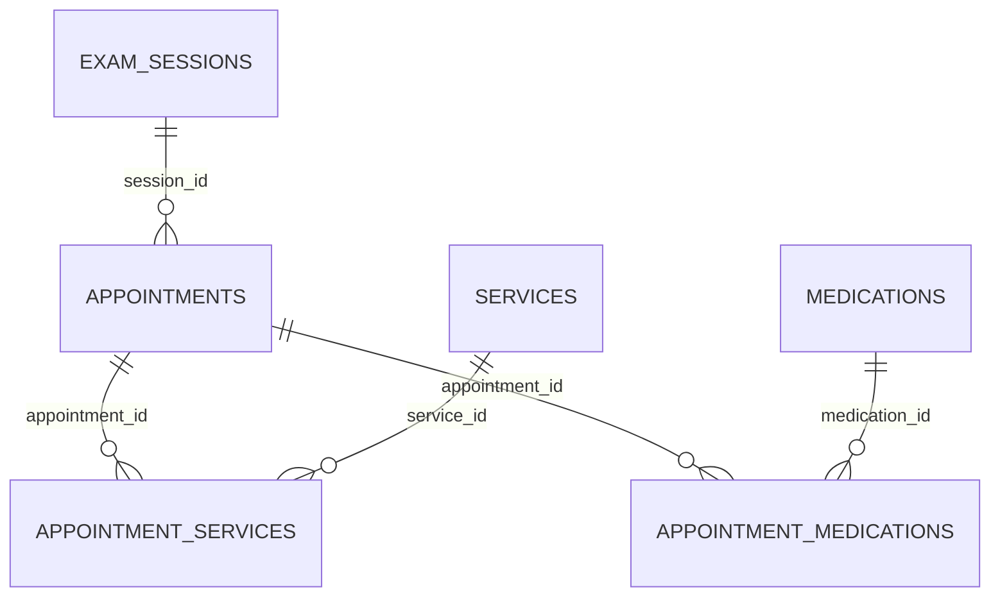

# Clinic service

Service Spring Boot 3.5.16, Java 17+, PostgreSQL; mặc định cổng **9003**.
Quản lý ca khám, đặt lịch, chỉ định dịch vụ, kết quả, chẩn đoán và kê thuốc.
Khám răng miệng dùng loại dịch vụ `DENTAL` và ghi chú vị trí răng, không có chuyên khoa.

Chỉ có thư mục `clinic-service` được thêm. Không thay đổi user-service, payment-service,
email-service, api-gateway, service-registry hoặc docker-compose.yml.

## 1. Chạy service

Tạo database PostgreSQL **riêng**, rỗng, tên `clinic_service`, bằng công cụ quản trị DB của bạn.
Không trỏ service vào database user_service hoặc database của service khác.

```powershell
cd C:\Users\LOQ\Desktop\datn\clinic-service
$env:JAVA_HOME = 'C:\Program Files\Java\jdk-21'
$env:CLINIC_DB_URL = 'jdbc:postgresql://localhost:5432/clinic_service'
$env:CLINIC_DB_USERNAME = 'postgres'
$env:CLINIC_DB_PASSWORD = '<mat-khau-postgresql>'
$env:JWT_SECRET = '<dung-cung-gia-tri-jwt.secret-key-cua-user-service>'
# Khóa riêng chỉ chia sẻ với backend payment-service khi tích hợp sau này.
$env:CLINIC_INTERNAL_API_KEY = '<khoa-noi-bo-ngau-nhien-dai>'
.\mvnw.cmd spring-boot:run
```

`JWT_SECRET` phải có ít nhất 64 byte UTF-8, tương thích JWT HS512 hiện tại:
claim `sub` là users.uuid, claim `role` là ADMIN / DOCTOR / PATIENT / USER.
Không cần sửa user-service, chỉ cấu hình cùng khóa ở môi trường clinic-service.
Không lưu khóa thật vào repository. API công khai của service yêu cầu Bearer token.

Flyway tạo đúng 6 bảng nghiệp vụ từ `src/main/resources/db/migration/V1__clinic_schema.sql`.
Ngoài ra Flyway có bảng kỹ thuật `flyway_schema_history` để theo dõi migration.
Hibernate chỉ validate schema, không tự sửa bằng ddl-auto=update.

Eureka mặc định tắt để chạy riêng. Khi cần đăng ký với registry hiện có:

```powershell
$env:EUREKA_ENABLED = 'true'
$env:EUREKA_URL = 'http://localhost:8761/eureka/'
```

## 2. Database



| Bảng | Nội dung |
|---|---|
| exam_sessions | doctor_uuid, exam_date, shift, examination_fee, max_patients, last_queue_number, status |
| appointments | session_id, patient_uuid, queue_number, examination_fee, status, expires_at, examination_invoice_id, examination_paid_at, symptoms, diagnosis, doctor_note, completed_at |
| services | name, service_type, price, room_number, description, active |
| appointment_services | appointment_id, service_id, invoice_id, service_name, service_type, unit_price, room_number, paid_at, status, result_url, note, result_added_by, completed_at |
| medications | name, strength, dosage_form, unit, description, active |
| appointment_medications | appointment_id, medication_id, medicine_name, strength, unit, quantity, dosage, frequency, duration_days, instruction |

Mỗi bảng có id UUID, created_at và version. Tiền VND nguyên NUMERIC(18,0).
Thời điểm lưu UTC; ngày khám tính theo Asia/Ho_Chi_Minh.
Các trường UUID của người dùng được giữ dạng chuỗi, tương thích users.uuid hiện có.
Không FK sang user-service hoặc payment-service, không có bảng invoices/payment_transactions tại đây.

Ca khám unique theo (exam_date, shift, doctor_uuid), ca sáng/chiều của mỗi bác sĩ chứa tối đa 20 người.
Phí khám, tên/giá/phòng/loại dịch vụ và thông tin thuốc được chốt tại thời điểm đặt/chỉ định/kê.

## 3. Quy tắc nghiệp vụ

- Bệnh nhân đặt cho chính mình; patient_uuid lấy từ token, không lấy từ request.
- Đặt lịch tạo PENDING_PAYMENT, chưa có queue_number. Giữ chỗ 10 phút, tính cả chỗ chờ trả tiền
  và lịch đã trả tiền vào sức chứa. Job mỗi phút dọn lịch hết hạn; lúc đặt mới cũng dọn ngay.
- Không đặt trùng ca khi còn lịch có hiệu lực. Có thể đặt lại sau khi hủy hoặc hết hạn.
- Xác nhận thanh toán nội bộ đúng số tiền mới cấp số thứ tự. Số riêng từng ca, theo thứ tự
  xác nhận; callback lặp cùng phiếu không cấp số mới. Khóa DB bảo vệ thao tác đặt/cấp số.
- Chỉ hủy lịch chưa thanh toán. Ca CLOSED chặn đặt mới; vẫn nhận thanh toán cho chỗ đang giữ còn hạn.
- Thanh toán đến khi lịch đã hủy/hết hạn trả 409, không cấp số. Payment-service cần đối soát khoản này.
- Chỉ bác sĩ của ca được bắt đầu khám, chỉ định, hủy dịch vụ chưa đưa vào phiếu và chốt hồ sơ.
- Bác sĩ chọn nhiều dịch vụ mỗi lần, có thể bổ sung trong cùng lượt khám.
- Mỗi nhóm dịch vụ được gắn một invoice_id do payment-service cung cấp. Sau khi gắn, nhóm bất biến;
  dịch vụ bổ sung phải dùng phiếu khác. Không hủy/sửa nhóm đã đưa vào phiếu ở bản đầu.
- paid_at chỉ được ghi qua API nội bộ sau xác nhận thanh toán. ADMIN cũng không có API công khai tự đánh dấu đã trả tiền.
- Chỉ ADMIN được bắt đầu thực hiện và gắn kết quả, bắt buộc dịch vụ đã thanh toán.
- LAB_TEST / IMAGING phải có link kết quả HTTP(S); DENTAL / OTHER được hoàn thành bằng ghi chú.
  Service chỉ lưu link, không upload, tải hoặc kiểm tra nội dung tệp.
- Bác sĩ chỉ chốt chẩn đoán và đơn thuốc khi tất cả dịch vụ không bị hủy đã trả tiền và COMPLETED.
  Có thể chốt không có dịch vụ hoặc không kê thuốc. Chẩn đoán, các thuốc và trạng thái COMPLETED
  được ghi cùng transaction. Hồ sơ đã chốt không sửa trong bản đầu.

## 4. API của clinic-service

Base URL: `http://localhost:9003`. Các API dưới `/clinic` dùng `Authorization: Bearer <access-token>`.
Response trả JSON trực tiếp; API danh sách có phân trang trả Spring Page.

| Method | Path | Quyền |
|---|---|---|
| POST | /clinic/sessions | ADMIN tạo ca |
| GET | /clinic/sessions?date=2026-10-25&doctorId=...&shift=MORNING&page=0&size=20 | PATIENT / USER xem ca OPEN (lọc theo ngày, bác sĩ, ca khám; có phân trang) kèm availableSlots & thông tin bác sĩ |
| GET | /clinic/sessions/my?date=2026-10-25&page=0&size=20 | DOCTOR xem ca của chính mình (lọc theo ngày hoặc phân trang) |
| GET | /clinic/sessions/admin?date=...&doctorId=...&shift=...&status=...&page=0&size=20 | ADMIN xem toàn bộ ca có lọc linh hoạt (ngày, bác sĩ, ca khám, trạng thái) và phân trang |
| PATCH | /clinic/sessions/{id}/status | ADMIN bật/tắt (toggle) trạng thái ca (OPEN <-> CLOSED, không cần request body) |
| GET | /clinic/sessions/{id}/appointments | ADMIN hoặc bác sĩ đúng ca |
| POST | /clinic/appointments | PATIENT / USER đặt lịch |
| GET | /clinic/appointments/my?page=0&size=20 | PATIENT / USER xem lịch của mình |
| GET | /clinic/appointments/patient/{patientId} | ADMIN xem danh sách tất cả lịch khám của một bệnh nhân/người dùng cụ thể |
| GET | /clinic/appointments/{id} | Chủ lịch, bác sĩ đúng ca hoặc ADMIN; gồm dịch vụ và đơn thuốc |
| POST | /clinic/appointments/{id}/cancel | Chủ lịch, chỉ khi chưa trả tiền |
| POST | /clinic/appointments/{id}/start | Bác sĩ đúng ca, sau thanh toán |
| GET | /clinic/services?type=...&keyword=...&page=0&size=20 | ADMIN hoặc DOCTOR xem dịch vụ (lọc theo type/serviceType, keyword; DOCTOR chỉ xem active; includeInactive=true chỉ ADMIN) |
| PATCH | /clinic/services/{id}/status | ADMIN bật/tắt (toggle) trạng thái hoạt động dịch vụ (active: true <-> false) |
| POST / PUT / DELETE | /clinic/services, /clinic/services/{id} | ADMIN tạo / cập nhật / xóa dịch vụ y tế |
| GET | /clinic/medications?keyword=...&page=0&size=20 | ADMIN hoặc DOCTOR xem thuốc (lọc theo keyword; DOCTOR chỉ xem active; includeInactive=true chỉ ADMIN) |
| PATCH | /clinic/medications/{id}/status | ADMIN bật/tắt (toggle) trạng thái hoạt động của thuốc (active: true <-> false) |
| POST / PUT / DELETE | /clinic/medications, /clinic/medications/{id} | ADMIN tạo / cập nhật / xóa thuốc |
| POST | /clinic/appointments/{id}/services | Bác sĩ đúng ca chỉ định nhiều dịch vụ |
| POST | /clinic/appointment-services/{id}/cancel | Bác sĩ đúng ca, chỉ dịch vụ chưa gắn phiếu |
| POST | /clinic/appointment-services/{id}/start | ADMIN; bắt buộc đã trả tiền |
| POST | /clinic/appointment-services/{id}/complete | ADMIN gắn link/ghi nhận hoàn tất |
| POST | /clinic/appointments/{id}/complete | Bác sĩ đúng ca chốt chẩn đoán và đơn thuốc |

Ví dụ tạo ca (ngày bằng hoặc sau ngày hiện tại; maxPatients không gửi sẽ mặc định 20):

```json
{
  "doctorId": 1,
  "examDate": "2026-10-25",
  "shift": "MORNING",
  "examinationFee": 150000,
  "maxPatients": 20
}
```


Đặt lịch:

```json
{ "sessionId": "<session-id>", "symptoms": "Đau răng" }
```

Tạo/cập nhật dịch vụ (`active` không gửi mặc định true; dùng false để ngừng cung cấp):

```json
{ "name": "Chụp X-quang răng", "serviceType": "IMAGING", "price": 200000, "roomNumber": "P201", "active": true }
```

Tạo/cập nhật thuốc:

```json
{ "name": "Tên thuốc", "strength": "Hàm lượng", "dosageForm": "Viên", "unit": "viên", "active": true }
```

Bác sĩ chỉ định:

```json
{ "items": [ { "serviceId": "<service-id-1>", "note": "Vị trí răng cần kiểm tra" }, { "serviceId": "<service-id-2>" } ] }
```

Admin hoàn tất dịch vụ:

```json
{ "resultUrl": "https://storage.example/results/result.pdf", "note": "Đã thực hiện" }
```

Bác sĩ chốt lượt khám; danh sách medications rỗng nếu không kê thuốc:

```json
{
  "diagnosis": "Chẩn đoán của bác sĩ",
  "doctorNote": "Lời dặn",
  "medications": [
    {
      "medicationId": "<medication-id>", "quantity": 6,
      "dosage": "Theo chỉ định bác sĩ", "frequency": "Theo chỉ định bác sĩ",
      "durationDays": 3, "instruction": "Hướng dẫn thêm"
    }
  ]
}
```

## 5. NOTE tích hợp các service còn lại — CHƯA sửa các service đó

### user-service

- Sử dụng token hiện tại và UUID người dùng; không thêm bảng hay trường bên user-service.
- Admin lấy danh sách bác sĩ qua API sẵn có `/users?role=DOCTOR`; chọn uuid cho ca khám.
- Clinic hiện kiểm tra định dạng doctorUuid, chưa gọi user-service xác minh UUID có tồn tại,
  còn ACTIVE và có role DOCTOR hay không. Admin cần chọn từ danh sách bác sĩ thực tế.
- JWT được xác thực chữ ký và hạn dùng tại clinic. Kiểm tra token đã logout/khóa tài khoản
  theo trạng thái trực tiếp cần cơ chế checkToken hiện có của Gateway/user-service khi tích hợp.

### payment-service — cần triển khai sau

Hiện payment-service CHƯA có invoices/payment_transactions và CHƯA gọi các API bên dưới.
Vì vậy đặt lịch hiện dừng ở PENDING_PAYMENT nếu chưa tích hợp backend thanh toán.
Không có mock công khai hay tự cấp số khi người dùng báo đã trả tiền.

Tất cả API nội bộ dùng header `X-Internal-Api-Key: <CLINIC_INTERNAL_API_KEY>`,
không dùng token bệnh nhân. Để trống khóa thì các API này trả 503. Không đưa khóa vào frontend.

| Method | Path | Công dụng |
|---|---|---|
| GET | /internal/clinic/appointments/{id}/examination-charge | Lấy patientUuid và phí khám đã chốt |
| POST | /internal/clinic/appointments/{id}/service-invoices | Gắn invoiceId vào đúng nhóm dịch vụ; trả patientUuid và tổng tiền do clinic tính |
| POST | /internal/clinic/payments/examination-confirmed | Xác nhận phí khám và cấp số |
| POST | /internal/clinic/payments/services-confirmed | Xác nhận phí của nhóm dịch vụ |

Gắn phiếu dịch vụ:

```json
{ "invoiceId": "<uuid-phieu-do-payment-service-tao>", "itemIds": ["<appointment-service-id-1>", "<appointment-service-id-2>"] }
```

Gọi lại cùng invoiceId + cùng tập itemIds trả cùng nhóm, không tạo thêm dịch vụ.
Đổi tập itemIds cho invoiceId đã gắn trả 409. Các item phải cùng một appointment.

Body xác nhận thanh toán cho cả hai API:

```json
{ "appointmentId": "<appointment-id>", "invoiceId": "<invoice-id>", "amount": 150000 }
```

Payment-service cần tự triển khai:

1. Xác thực người dùng là chủ lịch trước khi tạo hóa đơn, vì API nội bộ chỉ tin backend gọi nó.
2. Với phí khám: lấy charge từ clinic và tạo hóa đơn EXAMINATION.
3. Với dịch vụ: tạo invoiceId, gọi clinic để chốt nhóm và lấy tổng tiền; lưu hóa đơn SERVICE.
   Giữ nguyên invoiceId khi retry nếu lỗi mạng. Hợp đồng này yêu cầu payment-service dùng UUID cho invoice.
4. Không tin amount từ frontend. Đối chiếu số tiền, mã giao dịch và chữ ký VNPay.
5. Sau IPN/đối soát thành công và lưu giao dịch, gọi endpoint confirmed tương ứng.
6. Retry xác nhận cho clinic khi lỗi mạng/5xx; không tạo invoice khác khi retry.
   Xác nhận trùng cùng phiếu không cấp số lần hai, không mở khóa dịch vụ khác.
7. Nếu phí khám đến sau khi lịch hết hạn: clinic trả 409; payment-service phải ghi nhận tiền
   đã nhận và chuyển đối soát/hoàn tiền, không báo đã có lịch khám.
8. Không tái sử dụng một invoiceId cho các loại phí hoặc các lịch khác nhau.
   Bản đầu chưa hỗ trợ hủy hóa đơn dịch vụ đã gắn, thanh toán từng phần hay hoàn tiền tự động.

### api-gateway / registry

- Gateway hiện CHƯA có route /clinic/**. Trước mắt gọi trực tiếp cổng 9003.
- Sau này thêm route /clinic/** đến lb://clinic-service và bật EUREKA_ENABLED.
- Không công khai route /internal/clinic/** qua Gateway.

### email-service

Chưa gọi email-service, chưa phát email nhắc lịch/thanh toán/kết quả. Có thể bổ sung sau,
không bắt buộc để chạy các API clinic hiện tại.

## 6. Kiểm thử / đóng gói

```powershell
.\mvnw.cmd test
.\mvnw.cmd package
```

Test chạy H2 ở chế độ PostgreSQL, dùng Flyway cùng migration và JWT giả chỉ trong test;
không gọi các service khác hoặc VNPay, không ghi PostgreSQL thực tế.
Kiểm thử nghiệp vụ bao gồm sức chứa khi đặt đồng thời, cấp số khi callback đồng thời/lặp,
hết hạn giữ chỗ, phân quyền, nhóm dịch vụ, điều kiện trả kết quả và chốt đơn thuốc.
Schema được kiểm chứng trên H2 trong test; cần chạy migration trên PostgreSQL riêng khi triển khai.
